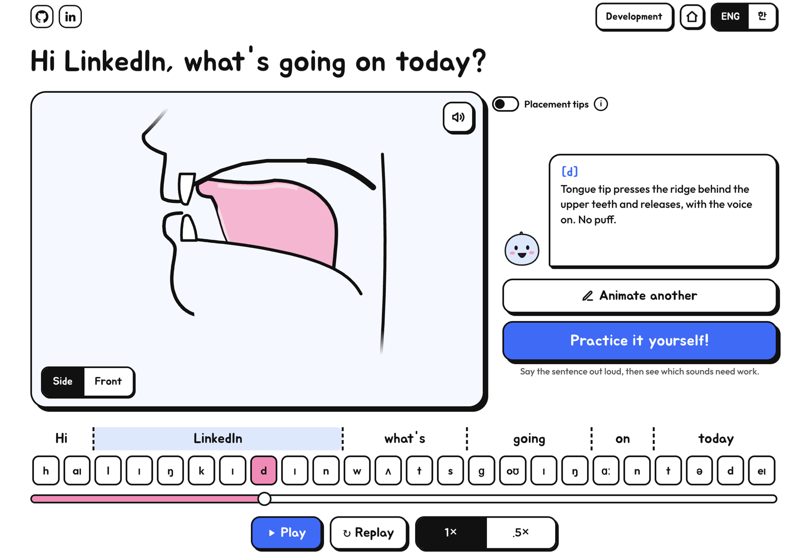
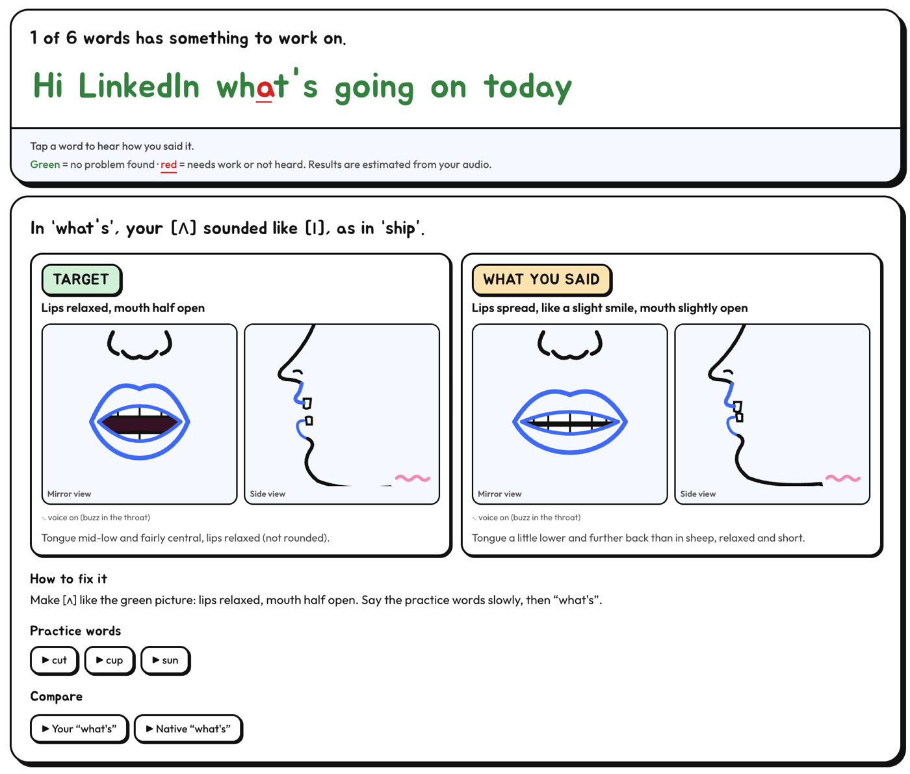

# Pronunciation Coach (Korean ↔ English)

Type any English or Korean sentence and watch a native speaker's tongue, teeth and lips say it, sound by sound. Then record yourself and see which sounds need work, with a picture of what your mouth did and how to fix it.

<table>
  <tr>
    <td width="50%" valign="top"></td>
    <td width="50%" valign="top"></td>
  </tr>
  <tr>
    <td align="center"><b>1. Watch the native mouth</b><br>A side view of the target sound, in sync with the audio</td>
    <td align="center"><b>2. Say it, see what to fix</b><br>Green passed, red needs work, with the target and what was heard side by side</td>
  </tr>
</table>

<!-- results:start (generated by `python -m eval.readme_results`; edits here are overwritten) -->
## Results: Korean speakers learning English

All numbers are on **Korean speakers of English who were never used for training or tuning** (L2-ARCTIC, its suitcase corpus, and the Speech Accent Archive). Each cell is a count with a 95% interval. Small counts mean wide intervals. Everything the app reports about your pronunciation is estimated from audio.

### Sound by sound

A sound check is on in the app only if, on these test speakers, at most 0.5% of correctly said sounds get flagged, at least half of its red marks are real errors, and it catches at least one error. Thresholds are tuned on other speakers. **Baseline:** flag every sound the phoneme recognizer transcribes differently from the target (no confidence margin, no tuning).

| Sound (target → heard) | In the app | Real errors caught | Correct sounds wrongly flagged | Red marks that were real errors | Baseline: caught | Baseline: wrongly flagged |
|---|---|---|---|---|---|---|
| English R said as L | yes | 9/18 (50%; 29–71%) | 1/1,070 (0.09%; 0.02–0.53%) | 90% | 12/18 (67%; 44–84%) | 127/1,070 (12%; 10–14%) |
| TH (as in *think*) said as S | yes | 1/64 (1.6%; 0.28–8.3%) | 0/155 (0.00%; 0.00–2.4%) | 100% | 46/64 (72%; 60–81%) | 18/155 (12%; 7.5–18%) |
| short i (*ship*) said as long ee (*sheep*) | yes | 7/187 (3.7%; 1.8–7.5%) | 6/1,401 (0.43%; 0.20–0.93%) | 54% | 60/187 (32%; 26–39%) | 102/1,401 (7.3%; 6.0–8.8%) |
| extra vowel after a final consonant (*bus-eu*) | yes | 17/85 (20%; 13–30%) | 9/4,151 (0.22%; 0.11–0.41%) | 65% | 45/85 (53%; 42–63%) | 60/4,151 (1.5%; 1.1–1.9%) |
| English L said as R | off (failed the bar) | 13/37 (35%; 22–51%) | 13/1,002 (1.3%; 0.76–2.2%) | 50% | 21/37 (57%; 41–71%) | 40/1,002 (4.0%; 2.9–5.4%) |
| F said as P | off (failed the bar) | 8/14 (57%; 33–79%) | 10/604 (1.7%; 0.90–3.0%) | 44% | 8/14 (57%; 33–79%) | 9/604 (1.5%; 0.79–2.8%) |
| V said as B | off (failed the bar) | 11/22 (50%; 31–69%) | 15/474 (3.2%; 1.9–5.2%) | 42% | 12/22 (55%; 35–73%) | 44/474 (9.3%; 7.0–12%) |
| TH (as in *this*) said as D | off (failed the bar) | 78/619 (13%; 10–15%) | 14/352 (4.0%; 2.4–6.6%) | 85% | 476/619 (77%; 73–80%) | 229/352 (65%; 60–70%) |
| long ee (*sheep*) said as short i (*ship*) | off (failed the bar) | 9/83 (11%; 5.8–19%) | 8/1,080 (0.74%; 0.38–1.5%) | 53% | 40/83 (48%; 38–59%) | 24/1,080 (2.2%; 1.5–3.3%) |

### Every other sound: any sound said as another, or left out

The checks above cover the mistakes the app teaches by name. A second check looks at every other sound. No corpus labels every possible swap, so the mistakes are made on the text side: a native's correct reading of *testing*, scored against the target *tasting*, is a learner who said [ɛ] where [eɪ] was wanted. Natives are CMU ARCTIC voices: 5 tune the cut-offs and 4 others test them (5 of the 9 voices have no license file, so only totals are reported and their audio is never shared). The cut-offs allow at most 5% of correct tuning sentences to have any red, a cap picked from a 2% / 5% / 10% table. The swaps are clean native sounds, so the catch rates are likely higher than on real learner errors. A stressed sound pair the tuning voices never blurred (672 pairs, such as *lucky* said *lacky*) gets a gentler cut (0.8), since a learner's swap is less clean than a made-up one. The last row is the real check: L2-ARCTIC sounds the annotators marked as said as another sound.

| Every-sound check | Result |
|---|---|
| Native test sentences with a wrong red | 180/3,984 (4.5%; 3.9–5.2%) |
| Korean speakers' sentences with a red on a sound the annotators marked correct | 49/600 (8.2%; 6.2–11%) |
| A stressed sound swapped in the text: caught | 9,568/9,891 (96.7%; 96.4–97.1%) |
| ... vowels / consonants | 2,378/2,576 (92.3%; 91.2–93.3%) / 7,190/7,315 (98.3%; 98.0–98.6%) |
| ... and the sound really said named right | 9,320/9,568 (97.4%; 97.1–97.7%) |
| A sound added to the text that was never said: caught as left out | 4,191/7,918 (53%; 52–54%) |
| Real mistakes by the Korean speakers (annotated as another sound): caught | 100/1,518 (6.6%; 5.5–8.0%) |

### Did they read the sentence? Was each word said?

600 readings by L2-ARCTIC's 4 Korean speakers, edited so the right answer is known: a word cut out of the audio, one word of the text swapped for another, the text of a different sentence, or silence/noise in place of speech.

| Sentence check (cap: 1% of correct readings rejected) | Result |
|---|---|
| Correct readings wrongly rejected | 0/600 (0.00%; 0.00–0.64%) |
| Text of a different sentence: rejected | 598/600 (99.7%; 98.8–99.9%) |
| Silence, noise or a beep: rejected | 24/24 (100%; 86–100%) |
| One word swapped: rejected (left to the word check) | 2/600 (0.33%; 0.09–1.2%) |
| One word cut out: rejected (left to the word check) | 6/600 (1.0%; 0.46–2.2%) |

| Word check (cap: 0.2% of spoken words called "not heard") | Result |
|---|---|
| Words a human marked correct, wrongly called "not heard" | 2/3,919 (0.05%; 0.01–0.19%) |
| All spoken words, wrongly called "not heard" | 8/5,620 (0.14%; 0.07–0.28%) |
| A word cut out of the audio: caught | 295/600 (49%; 45–53%) |
| A word swapped in the text: caught | 360/600 (60%; 56–64%) |

**Processing time per sentence:** median 0.21 s; the slowest 5% took 0.30 s or more (longest 0.40 s). Measured on 600 readings by the same 4 Korean speakers (median recording 3.5 s), on CPU only (Apple M3 Pro, 6 CPU threads), model already loaded, network not included.

**On the live server (Hugging Face Space, cpu-basic hardware):** median 1.33 s from sending a recording to having the result; the slowest 5% took 2.13 s or more (longest 3.18 s). Same 600 readings, sent one at a time from a laptop, network included (an empty request took 0.10 s on its own).

## Results: English speakers learning Korean

No learner Korean with sound-by-sound error labels was available, so there is **no real detection rate** for Korean. Instead, each of ten candidate checks was run on the Korean-trained listener (`slplab/wav2vec2-xls-r-300m_phone-mfa_korean`) and had to pass four bars, all set before the first run:

1. **Native speakers:** at most 0.5% of correctly said sounds flagged (native read speech from the Zeroth corpus, speakers not used to tune the cut-off).
2. **Top-rated learners:** at most 1% of their sounds flagged. AI Hub's learner speech: 4,453 readings by 151 English-speaking learners of Korean, each sentence rated high, middle or low by human raters. Top-rated readings still contain some real mistakes, so this is an upper bound on false alarms for good learners.
3. **Worse speech, more red:** sounds are flagged more often in middle- and low-rated readings than in high-rated ones, with the 95% interval of the gap (resampling whole speakers) above zero.
4. **Simulated errors:** at least 25% caught, where an error is simulated by swapping one letter in the text of a native recording (for ㅜ said like ㅡ: a native says 그, the text asks for 구). These are clean native sounds, so this bar is optimistic: it can only rule a check out.

| Sound (target → heard) | In the app | 1. Natives: correct sounds flagged | 2. Top-rated learners: sounds flagged | 3. Flagged: top-rated → lower-rated (gap, 95%) | 4. Simulated errors caught |
|---|---|---|---|---|---|
| ㅜ said like ㅡ | yes | 2/1,319 (0.15%; 0.04–0.55%) | 23/4,168 (0.55%; 0.37–0.83%) | 0.55% → 1.5% (+0.49 to +1.5 points) | 358/456 (79%; 75–82%) |
| plain ㅂ ㄷ ㄱ said tense (like ㅃ ㄸ ㄲ) | yes | 14/4,691 (0.30%; 0.18–0.50%) | 189/19,657 (0.96%; 0.83–1.1%) | 0.96% → 2.3% (+0.83 to +1.8 points) | 170/213 (80%; 74–85%) |
| ㅓ said like ㅗ | off (failed bar 2) | 7/1,830 (0.38%; 0.19–0.79%) | 292/10,061 (2.9%; 2.6–3.2%) | 2.9% → 5.0% (+0.98 to +3.6 points) | 350/445 (79%; 75–82%) |
| ㅗ said like ㅓ | off (failed bar 2) | 5/1,737 (0.29%; 0.12–0.67%) | 276/7,089 (3.9%; 3.5–4.4%) | 3.9% → 7.4% (+2.2 to +4.9 points) | 365/443 (82%; 79–86%) |
| ㅡ said like ㅜ | off (failed bar 1) | 14/2,404 (0.58%; 0.35–0.98%) | 87/9,154 (0.95%; 0.77–1.2%) | 0.95% → 1.4% (+0.04 to +0.94 points) | 362/423 (86%; 82–89%) |
| plain ㅂ ㄷ ㄱ said aspirated (like ㅍ ㅌ ㅋ) | off (failed bar 2) | 17/4,691 (0.36%; 0.23–0.58%) | 417/19,657 (2.1%; 1.9–2.3%) | 2.1% → 4.2% (+1.4 to +2.7 points) | 401/445 (90.1%; 87–92.5%) |
| tense ㅃ ㄸ ㄲ said plain (like ㅂ ㄷ ㄱ) | off (failed bars 1, 2) | 3/296 (1.0%; 0.35–2.9%) | 89/2,153 (4.1%; 3.4–5.1%) | 4.1% → 9.7% (+3.6 to +7.3 points) | 987/1,255 (79%; 76–81%) |
| tense ㅃ ㄸ ㄲ said aspirated (like ㅍ ㅌ ㅋ) | off (failed bar 2) | 0/296 (0.00%; 0.00–1.3%) | 32/2,153 (1.5%; 1.1–2.1%) | 1.5% → 3.3% (+0.80 to +2.7 points) | 286/468 (61%; 57–65%) |
| aspirated ㅍ ㅌ ㅋ said plain (like ㅂ ㄷ ㄱ) | off (failed bars 1, 2) | 4/697 (0.57%; 0.22–1.5%) | 121/2,068 (5.9%; 4.9–7.0%) | 5.9% → 10% (+2.0 to +6.6 points) | 1,021/1,255 (81%; 79–83%) |
| aspirated ㅍ ㅌ ㅋ said tense (like ㅃ ㄸ ㄲ) | off (failed bars 1, 2, 3) | 7/697 (1.0%; 0.49–2.1%) | 55/2,068 (2.7%; 2.1–3.5%) | 2.7% → 2.9% (−1.0 to +1.6 points) | 188/237 (79%; 74–84%) |

### Did they read the sentence? Was each word said?

The same two checks as for English, on the Korean-trained listener. Natives are 457 Zeroth test readings, edited the same way (a word cut out, a word swapped, another sentence's text, noise). Learners are AI Hub readings, high / middle / low rated: they read the right text, so every rejection or "not heard" there counts as a false alarm (an upper bound, since a learner may really have skipped a word). Bars set before the run: natives at most 1% of readings rejected and 0.5% of words called not heard; learners at most 2% and 1%.

| Korean sentence and word checks | Result |
|---|---|
| Native readings wrongly rejected | 1/457 (0.22%; 0.04–1.2%) |
| Text of a different sentence: rejected | 456/457 (99.8%; 98.8–100.0%) |
| Silence, noise or a beep: rejected | 24/24 (100%; 86–100%) |
| Learner readings rejected (high / middle / low) | 0/635 (0.00%; 0.00–0.60%) / 0/772 (0.00%; 0.00–0.50%) / 3/44 (6.8%; 2.4–18%) |
| Native words wrongly called "not heard" | 15/6,623 (0.23%; 0.14–0.37%) |
| Learner words called "not heard" (high / middle / low) | 6/9,850 (0.06%; 0.03–0.13%) / 14/12,107 (0.12%; 0.07–0.19%) / 1/672 (0.15%; 0.03–0.84%) |
| A word cut out of the audio: caught | 282/457 (62%; 57–66%) |
| A word swapped in the text: caught | 230/457 (50%; 46–55%) |

### Every other Korean sound: any sound said as another, or left out

Like the English one, with mistakes made on the text side of native Zeroth readings (16 speakers tune the cut-offs, the 10 test speakers check them) and learner readings from AI Hub. Bars set before the run: native test readings with any red at most 7.5%, made-up swaps caught at least 50%, lower-rated learners red more often than high-rated ones, and red marks (not just a soft hint) only if at most 20% of high-rated learner readings get any red. The left-out rule had to catch 25% to stay on. It passed every bar, so it marks sounds red. Learner readings may contain real mistakes, so their red shares are an upper bound on false alarms. A sound turns green only when the listener heard that sound there.

| Every-sound Korean check | Result |
|---|---|
| Native test readings with a wrong red | 16/457 (3.5%; 2.2–5.6%) |
| Learner readings with any red (high / middle / low rated) | 66/635 (10%; 8.2–13%) / 111/806 (14%; 12–16%) / 40/195 (21%; 15–27%) |
| Middle and low rated minus high rated (95%, resampling speakers) | +0.91 to +8.6 points |
| A sound swapped in the text: caught | 1,106/1,805 (61%; 59–64%) |
| ... vowels / consonants / final stops | 470/787 (60%; 56–63%) / 630/972 (65%; 62–68%) / 6/46 (13%; 6.1–26%) |
| ... and the sound really said named right | 1,044/1,106 (94.4%; 92.9–95.6%) |
| ... missed and shown green instead | 11/1,805 (0.61%; 0.34–1.1%) |
| Native test sounds shown green | 40,121/43,161 (93.0%; 92.7–93.2%) |
| A sound added to the text: caught as left out | 38/914 (4.2%; 3.0–5.7%) (rule off) |
<!-- results:end -->

## What the results show

**Keeping false alarms low is what makes a phoneme recognizer usable for feedback, and it costs detection.** The baseline (flag every sound the recognizer transcribes differently from the target) catches more errors on every sound pair, but it also marks many correctly said sounds red: 12% of correct English R, 12% of correct TH in *think*, and 65% of correct TH in *this*. The app calls a sound wrong only when the recognizer's evidence for the other sound passes a cut-off tuned on other speakers, set so that at most 0.5% of correct sounds are flagged. For R said as L, this keeps most of the detection (9 of 18 errors caught, against 12 of 18 for the baseline) and cuts false alarms from 127 to 1 out of 1,070 correct R sounds. A learner who says a sound right and sees it marked red stops trusting every other mark, so the app is built to miss an error rather than flag a correct sound.

**Four of nine English sound pairs pass the bar; five stay off.** L said as R, F said as P, V said as B, TH (*this*) said as D, and *sheep* said as *ship* all flag too many correct sounds on the test speakers. For F said as P, the tuned system is no better than the baseline (8 of 14 errors caught by both; 10 against 9 false alarms out of 604).

**Two of the live checks catch very little.** TH said as S catches 1 of 64 errors, and *ship* said as *sheep* catches 7 of 187. They are on because they almost never flag a correct sound, but most errors of these two kinds go unmarked. TH said as S is the weakest live pair, and the weakness is not only the small Korean test set: even on the tuning speakers, a cut-off that keeps false alarms at 0.5% catches 33 of 347 errors (9.5%). The recognizer's confidence barely separates a correct TH from a TH said as S. For *ship* said as *sheep*, 7 of 13 red marks are real errors, just over the bar of half.

**Fine-tuning the recognizer on what learners actually said helped most on the common errors.** We fine-tuned the wav2vec2 phoneme recognizer with CTC on about 11 hours of non-native English, labelled with the sounds each speaker actually produced rather than the sounds in the text. No Korean speaker was used for training or tuning. With the same tuning rule and the same test speakers, the extra-vowel check went from 8 to 17 of 85 errors caught (9 false alarms out of 4,151 in both cases) and became the fourth pair to pass. *Ship* said as *sheep* went from 2 to 7 of 187 caught, with false alarms rising from 2 to 6 out of 1,401, still under the cap. R said as L went from 11 to 9 of 18 caught, a difference too small to read anything into.

**The sentence and word checks are reliable enough to run.** No correct reading out of 600 was rejected, and 598 of 600 readings of a different sentence were. A word cut out of the audio is caught about half the time (295 of 600), while 2 of 3,919 words a human marked correct were wrongly called "not heard". A single swapped or missing word is too small a change for the sentence check by design; the word check handles those.

**The recognizer's overall scores reward slow speech, so they are not a fluency score.** On AI Hub's Korean learner speech data (English-speaking learners reading Korean; 4,453 recordings from 151 speakers, each sentence rated high, middle or low by human raters), the sentence-level "how much was heard" score goes *down* as the human rating goes *up* (Spearman ρ = −0.25; the confidence score −0.31). Higher-rated speakers speak faster (8.8 expected sounds per second on high-rated sentences against 4.7 on the 160 low-rated ones; ρ = 0.54), and faster speech gets lower scores. With speaking rate held fixed, the relationship shrinks to ρ = −0.07 for the heard score and −0.11 for confidence: most of it goes away, though not all. Harder sentences for better speakers don't explain it: sentence length is the same across ratings (about 98 sounds), and among readers of the same script the scores still fall as the rating rises (ρ = −0.27 and −0.33). In the same data, two candidate Korean checks fire more often for lower-rated learners, which is the right direction: ㄹ said like English L (2.2%, 5.3%, 8.5% of sounds for high, middle, low) and ㅃ/ㄸ/ㄲ said with an English-style puff of air (3.3%, 7.1%, 12.7%). Without per-sound labels we can't tell how much of that is real errors and how much is false alarms, so neither went live on that evidence alone; the four bars below are what a Korean check must pass instead.

**Two of ten Korean checks pass all four bars: ㅜ said like ㅡ, and a plain ㅂ ㄷ ㄱ said tense.** The bar that failed most checks is the one on top-rated learners: seven of the eight that stay off flag between 1.5% and 5.9% of the sounds of learners whom raters scored high, against a cap of 1%. Four fail on native speakers, three of them stop checks with few native test sounds (296 tense and 697 aspirated stops). The plain-said-tense check passes the top-rated bar narrowly (0.96% against 1%, with an interval reaching 1.1%). Every check caught most simulated errors (61% to 90%), so that bar ruled none out: the false-alarm bars decided which checks went live.

**The every-sound checks cover all the other sounds, under a looser cap and with clear weak spots.** The named checks flag at most 0.5% of correct sounds, which leaves most sounds unchecked. The every-sound checks are tuned so that at most 5% of correct tuning sentences get any red. In English that catches 97% of stressed sounds swapped in the text (92% of vowels), and 8.2% of the Korean speakers' sentences get a red on a sound the annotators marked correct. On real mistakes it does far worse: of the 1,518 sounds L2-ARCTIC's annotators marked as said as another sound by the Korean speakers, it catches 100 (6.6%). Re-tuning the cut-offs does not close that gap: the most any setting caught was 234 (15%), at the cost of a wrong red in 27% of the Korean speakers' sentences, and each extra catch cost about one wrong red. The limit is the recognizer, not the cut-offs: for the largest group of misses (593), it is at least 50% sure it heard the right sound. In Korean it catches 61% of swaps but only 6 of 46 final stops, and the left-out rule caught only 4.2% of added sounds, so it is off. Readings by high-rated learners get some red 10% of the time, against 3.5% for natives, and low-rated readings 21% of the time, which is the right direction. A missed Korean swap almost never turns green (11 of 1,805), because a Korean sound turns green only when the recognizer heard that exact sound.

## Method

```
recording + target text
  1. expected sounds    text → phonemes (IPA)                       g2p_en (English), g2pk (Korean)
  2. one model pass     audio → phoneme probabilities per 20 ms     wav2vec2 phoneme recognizer
       a. forced alignment: where each expected sound is (start/end times)
       b. free recognition: what was actually heard, with no text forced on it
  3. line-up            expected vs heard → match / swapped / dropped / extra
  4. did they say it?   sentence check, then a "was each word heard?" check
  5. sound checks       one tuned rule per taught mistake, then every other sound → red, green or unchecked
  6. text mapping       sounds → letters (English) or syllable blocks and jamo (Korean)
→ JSON: colours, times for part-by-part replay, what was heard, which tip to show
```

**1. Expected sounds.** English text goes through g2p_en (CMUdict, with a neural guess for unknown words) to ARPAbet, then to IPA. Korean text goes through g2pk, which rewrites it as it is *said* (sound-change rules: 같이 → 가치, 국물 → 궁물), and each jamo is then mapped to IPA.

**2. One model pass, used twice.** A wav2vec2 phoneme recognizer (`facebook/wav2vec2-xlsr-53-espeak-cv-ft`; for English, a version fine-tuned on learner speech, see below) turns the audio into a probability for each of its 392 phoneme symbols in every 20 ms frame. *Forced alignment* (torchaudio's CTC `forced_align`) finds the most likely place in those frames for each expected sound, in order, which gives every sound and word a start and end time. *Free recognition* (greedy CTC decoding) reads off the sounds the model hears without being told the text. For Korean, a second, Korean-trained recognizer (`slplab/wav2vec2-xls-r-300m_phone-mfa_korean`, Apache-2.0, pinned revision) makes the judgements, with its own forced alignment, because the main one can't tell plain ㅂ, tense ㅃ and aspirated ㅍ apart.

**3. Line-up.** An edit-distance alignment of expected and heard sounds (swapping a vowel for a vowel costs less than a vowel for a consonant) says, for each expected sound, whether it was heard as itself, heard as another sound, or dropped, and which extra sounds were heard after it.

**4. Did they say this sentence?** Forced alignment always places every expected sound somewhere, even in silence or in a different sentence. So before any colouring, a sentence check compares two whole-sentence numbers with tuned thresholds: the share of expected sounds heard as themselves, and the aligner's average confidence (for English on the fine-tuned listener, tuning left only the confidence threshold active); a recording that fails gets "couldn't match your recording" and no colours. Then a word check marks a word "not heard" when almost none of its sounds were heard and the aligner's confidence in them is very low. For Korean, both checks read the Korean-trained recognizer.

**5. Sound checks.** The app first checks the specific mistakes it teaches. For each target sound in one of those pairs, it measures a *margin*: the model's peak probability for the wrong sound minus its peak probability for the right sound, inside the sound's aligned time window. The sound is red if the margin is above a cut-off tuned for that pair; for three of the four live pairs, the free recognizer must also have written the wrong sound in that place. For R said as L, the tuned cut-off ended at its lowest value, so in practice an R turns red whenever the recognizer writes L in its place. The extra-vowel check uses the confidence of a vowel heard right after a word-final consonant. Korean uses the same two-part rule on the Korean recognizer: a margin above a cut-off tuned on native speakers, and the recognizer wrote the wrong sound in that place.

**The every-sound check.** Every other sound gets a simpler test, in both languages. Inside its aligned window, a sound is red when the free recognizer wrote a different sound there and the right sound barely shows up. In English it is also red when another sound's peak beats the right sound's peak by a wide margin (0.98, set by the pairs natives blur on their own, such as ɛ and æ; a stressed pair the native tuning voices never blurred, such as ʌ and æ, needs only 0.8), and counted as left out when the recognizer skipped it and it barely shows up. Normal native variants are never red: in English a weak vowel reduced to "uh", in Korean a sound-change rule not applied (학교 said without the tensing), ㅢ said as ㅣ, ㅔ or ㅡ, or ㅎ fading between voiced sounds. These rules come from phonetics, not from fitting, and were fixed before the test speakers were read. A sound a named check already marked red keeps that verdict and its tip, and a swap that matches a hand-written tip uses it. A sound is green only if a check looked at it and passed (for Korean, only if the recognizer also heard that exact sound there); every other sound is shown plain, not green.

**Tuning and the bar.** Each pair's cut-off is the most sensitive one that flags at most 0.5% of correctly said sounds on the *tuning* speakers (never the Korean speakers). The pair then goes live only if, on the Korean test speakers, it also stays at or under 0.5% false alarms, at least half of its red marks are real errors, and it catches at least one error. Two richer rules were also tried: an F3 (third formant) tie-breaker for R and L measured with Praat, and per-pair logistic-regression detectors over 13 waveform measurements (formants, duration, voicing, frication noise, closure, burst). The app currently runs the margin rule for every live pair.

**Fine-tuning the listener.** The recognizer was originally trained to write down speech the way a dictionary spells it. It was fine-tuned with CTC on about 11 hours of English (L2-ARCTIC, its suitcase corpus, speechocean762 and the Speech Accent Archive, about 1,060 speakers of many first languages), with targets set to the sounds each speaker *actually* said, from the corpora's phonetic annotations: "light" said with an R is trained as `ɹ aɪ t`. For speechocean762, which marks errors without saying what was said instead, only recordings where every sound was judged correct were used. The feature encoder stayed frozen; the transformer layers and output layer were trained. Speakers were split, never recordings: a separate dev group picked the best checkpoint and tuned the cut-offs, and every Korean speaker was left out of both, as the test set. The fine-tune saw English only, so the Korean sentence, word and sound checks all use the Korean-trained recognizer; the original model still gives the Korean sound times used for replay.

**6. Text mapping.** English sounds map back to the letters that spell them, so the UI can mark the failing letters inside a word. Korean sounds map back to the written syllable block and the jamo inside it, including sounds that moved: in 같이 (said 가치), the ㅊ sound is coloured on the written ㅌ in 같, because that is the letter the learner reads.

**Feedback and reference audio.** Tapping a red part opens a card with a side-view mouth diagram of the target sound and the sound that was probably made, built from an articulation table taken from cited phonetics references (the IPA chart, Ladefoged & Johnson, and published descriptions of Korean phonetics), plus a fixed, pre-written tip and practice words for that mistake. For a mistake found by an every-sound check, the tip is built from the sound table's own description of the target sound. Nothing in the card is generated at request time. Native reference audio is text-to-speech (Azure), cached, and run through the same aligner so each word or syllable can be replayed next to the learner's own. The native mouth animation shows the target pose of each sound, timed to that reference clip, with neighbouring sounds blended using a simplified dominance model of coarticulation (Cohen & Massaro, 1993). An LLM (Claude) is used only to show the English meaning of a typed Korean sentence, never for scoring.

**Test data.** English: L2-ARCTIC's 4 Korean speakers (sentences and suitcase stories) and the Speech Accent Archive's Korean speakers, none used for training or tuning, and 9 native US and Canadian voices from CMU ARCTIC for the every-sound check (5 tune, 4 test). The sentence and word checks were tested by editing those readings so the right answer is known (a word cut out, a word swapped, another sentence's text, noise). Korean: AI Hub's learner speech data (English-speaking learners, sentence-level ratings only) and native read speech from the Zeroth corpus (for the no-speech check, and to tune and test the Korean checks on speakers kept apart: 16 tune, 10 test).

## Limitations

- **Everything is estimated from audio.** The app never sees the tongue or lips. The mouth diagrams and the side-view animation show the *target* articulation for each sound, taken from phonetics reference tables, not a measurement of the user's mouth.
- **Many mistakes are not marked.** Green means a sound passed a check; sounds no check could confirm stay plain. The named English checks miss most errors of their kind (from 50% caught for R said as L down to 1.6% for TH said as S), and the every-sound checks miss about 3% of swapped stressed English sounds but 93% of the Korean speakers' real annotated English substitutions, 39% of swapped Korean sounds, 47% of left-out English sounds and almost all left-out Korean sounds. A sentence without red marks is not proof it was said correctly.
- **Some red marks are wrong.** At the bar of "at least half of red marks are real errors", up to one red mark in two can land on a correctly said sound (*ship* said as *sheep*: 7 of 13 right; extra vowel: 17 of 26). The every-sound checks put a wrong red in roughly 1 correct sentence in 20, and more for Korean speakers (4.5% of native English test sentences, 8.2% of the Korean speakers' English sentences, 3.5% of native Korean test readings).
- **Small test sets.** The Korean test speakers give only 18 R-said-as-L errors and 64 TH-said-as-S errors, so the 95% intervals in the table are wide. The sentence check's thresholds for the fine-tuned recognizer were tuned on 5 held-out speakers, and the word check's tuning set sits exactly at its cap; both are less certain than the test numbers alone suggest.
- **Read speech only.** All test data is read aloud from a script. Spontaneous speech, other microphones and noisier rooms are untested.
- **Korean grading has no measured detection rate.** Two named Korean mistakes have their own checks (ㅜ said like ㅡ, and a plain ㅂ ㄷ ㄱ said tense), and every other Korean sound gets the every-sound check. No learner Korean with sound-by-sound labels was available, so the false-alarm numbers are bounds from native speakers and rated learners, the catch rates (about 80% for the named checks, 61% for every sound) are on errors made in the text of native readings and are probably higher than on real learners, and the share of Korean red marks that are real errors is unknown. Final stops are weak (6 of 46 caught), left-out Korean sounds are not marked, the recognizer hears ㅐ and ㅔ as one sound so it never tells them apart, and a glide + vowel such as ㅕ is drawn with its vowel only. The native speakers (Zeroth) and the learners (AI Hub, phones) were recorded on different microphones. The processing times above are for English; Korean recordings also run the second recognizer and have not been timed.
- **Speed hurts the scores.** Fast, connected speech lowers the recognizer's confidence (see above), so a fluent speaker can score lower than a slow, careful one. The app never shows these scores as an overall grade.
- **Reference audio is synthetic.** Native reference recordings are text-to-speech, not human recordings.
- **Translations are machine-written.** English meanings of typed Korean sentences are written by an LLM and have not been checked by a native speaker.
- **The live timing is one visitor at a time.** It was measured from one laptop, sending recordings one after another to free shared hardware. Several visitors at once would wait longer, and that has not been measured.
